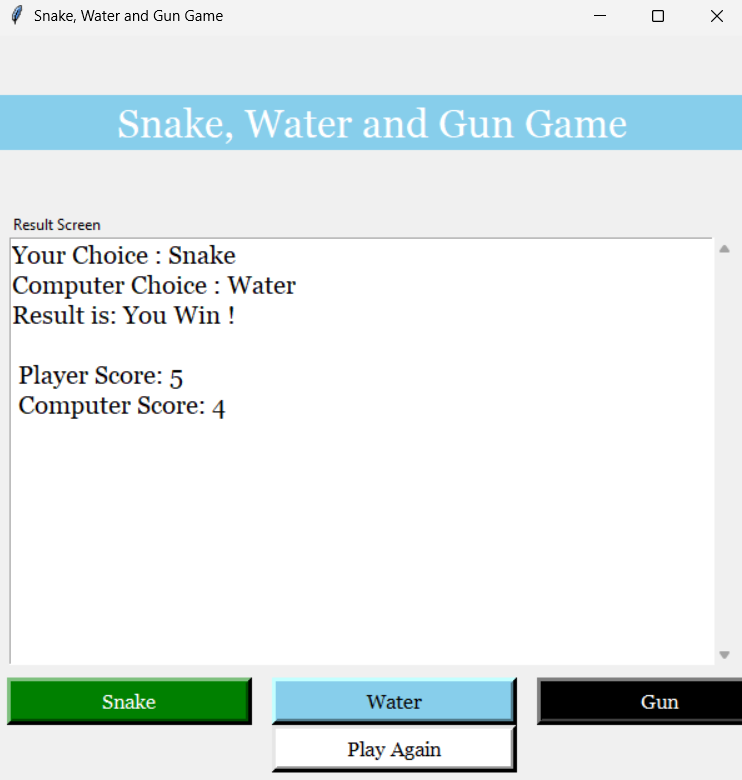

# 🐍 Snake Water Gun - Tkinter Edition

[](https://www.python.org/)

> 🎮 A modern, beginner-friendly implementation of the classic **Snake Water Gun** game, now with a **Tkinter GUI**! A fun twist on Rock Paper Scissors, built with Python.

---

## 🖼️ GUI Preview

<!-- Replace this with a real image or GIF -->


---

## ✨ Features

- 🐍 GUI powered by **Tkinter**
- 🤖 Random computer choice logic
- 🧠 Real-time score tracking
- 🔁 Restart functionality
- 🌗 Clean and modern UI design

---

## 🚀 Getting Started

### 🔧 Requirements

- Python 3.10 or above
- No external libraries required (Tkinter is included with Python)

### ▶️ Run the Game

```bash
git clone https://github.com/aksh-arch/project-1.git
cd project-1
python main.py
